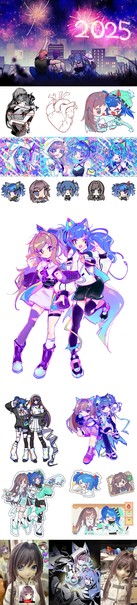
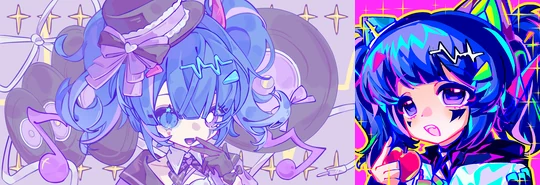
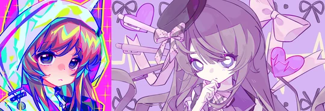

<table>
  <tr>
    <td colspan="2" align="center"></td>
    <td rowspan="5" align="center" valign="middle"></td>
  </tr>
  <tr>
    <td colspan="2" align="center">
      <picture>
        <source media="(prefers-color-scheme: dark)" srcset="https://raw.githubusercontent.com/LShayc1owN/LShayc1owN/output/github-contribution-grid-snake-dark.svg" />
        <source media="(prefers-color-scheme: light)" srcset="https://raw.githubusercontent.com/LShayc1owN/LShayc1owN/output/github-contribution-grid-snake.svg" />
        
      </picture>
    </td>
  </tr>
  <tr>
    <td colspan="2" align="center"></td>
  </tr>
  <tr>
    <td colspan="2" align="center"></td>
  </tr>
  <tr>
    <td colspan="2" align="center"></td>
  </tr>
</table>
